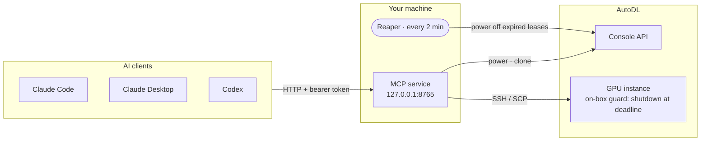

<div align="center">


<h3>Let AI agents rent AutoDL GPUs — and switch them off when done</h3>

<p>
  <a href="LICENSE"></a>
  
  
  
</p>

<p>
  <a href="README.md">中文</a> · <b>English</b>
  &nbsp;|&nbsp;
  <a href="#-quick-start">Quick start</a> ·
  <a href="#-tools">Tools</a> ·
  <a href="#-how-it-works">How it works</a> ·
  <a href="#%EF%B8%8F-configuration">Config</a> ·
  <a href="#%EF%B8%8F-security-notes">Security</a>
</p>

</div>

---

**Auto-AutoDL** is a long-running local [MCP](https://modelcontextprotocol.io) server that lets AI clients such as Claude Code, Claude Desktop and Codex acquire, use and release [AutoDL](https://www.autodl.com) GPU instances. Every window shares **one service**: agents never grab each other's machines, machines are powered off when done, and every step is logged. It talks to the console's API — no clicking through the web UI.

```text
You: run this training script on a 4090 and pull the checkpoint back when it's done
AI:  autodl_acquire → autodl_put → autodl_exec(background) → autodl_job_status → autodl_get → autodl_release ✓ powered off
```

> [!WARNING]
> **Disclaimer**
> - This is a personal project. It is **not affiliated with or endorsed by AutoDL**.
> - It uses the **undocumented internal API** of the AutoDL web console, which may break at any time. Make sure your use complies with AutoDL's terms of service.
> - Powering on and cloning instances **costs real money**. There are several layers of automatic shutdown, but bugs are possible — check your instances and balance in the console regularly. Provided "as is" under the MIT license; the authors are not liable for any charges or data loss.

## ✨ Features

<table>
<tr>
<td width="50%" valign="top">

**🎯 Unified allocation**<br>
Powers on a stopped instance with a free GPU; otherwise polls every second; if none frees up in time, clones an identical instance (including the data disk).

</td>
<td width="50%" valign="top">

**🔒 Lease isolation**<br>
Only the holder of a `lease_id` can run commands, transfer files or power off. Allocation runs under a cross-process lock, so concurrent agents never get the same machine or kill each other's.

</td>
</tr>
<tr>
<td valign="top">

**⏻ Three layers of auto-shutdown**<br>
Explicit `release` → in-service reaper → an on-instance guard that runs `shutdown` at the deadline. Billing stops even if your PC is off or the service is down.

</td>
<td valign="top">

**📜 Full audit trail**<br>
Append-only, millisecond-timestamped logs of platform operations and per-machine shell sessions. Common token / password patterns are redacted before writing, and root passwords are never returned to the AI.

</td>
</tr>
</table>

## 🚀 Quick start

**Requirements**: Python 3.10+; a local OpenSSH client (`ssh` / `scp`) with your public key installed on the AutoDL instances.

> Windows is the primary platform: clipboard login and the `install_*.ps1` scheduled tasks are Windows-only. On Linux / macOS the core works; run the service under systemd / launchd yourself.

**1. Install dependencies**

```bash
pip install -r requirements.txt
```

**2. SSH key**: `~/.ssh/id_ed25519` by default, with its public key added to your instances. Set `ssh_key` in `config.json` to use another key.

**3. Log in** (the token is stored only in `.secrets/auth.json`, which is git-ignored)

In a logged-in console tab, press <kbd>F12</kbd> → Console and run:

```js
copy(JSON.stringify({token:localStorage.token,app_version:localStorage.app_version}))
```

Then:

```bash
python autodl_cli.py login     # Windows: reads the clipboard
python autodl_cli.py login -   # Linux / macOS: paste, then press Ctrl-D
```

Repeat this step when the token expires.

**4. Start the service**

```powershell
# Windows autostart (recommended): scheduled task, auto-restart, no window. Add -DryRun to preview
powershell -ExecutionPolicy Bypass -File install_service.ps1
```

```bash
# Or run in the foreground
python mcp_server.py --http --port 8765
```

The access token is generated on first start at `.secrets/service_token`. **Never paste it into a chat or commit it.**

**5. Connect a client**: URL `http://127.0.0.1:8765/mcp`, header `Authorization: Bearer <token>`

```bash
claude mcp add --scope user --transport http autodl http://127.0.0.1:8765/mcp \
  --header "Authorization: Bearer <token>"
```

<details>
<summary><b>Codex</b> (<code>~/.codex/config.toml</code>; check key names against your Codex version, untested)</summary>

```toml
[mcp_servers.autodl]
url = "http://127.0.0.1:8765/mcp"
bearer_token_env_var = "AUTODL_MCP_TOKEN"   # set the token as user env var AUTODL_MCP_TOKEN first
tool_timeout_sec = 3600
```
</details>

<details>
<summary><b>Claude Desktop</b> (needs <code>mcp-remote</code> as an HTTP→stdio bridge, untested)</summary>

```json
"autodl": {
  "command": "npx",
  "args": ["-y", "mcp-remote", "http://127.0.0.1:8765/mcp", "--header", "Authorization:${AUTODL_AUTH}"],
  "env": {"AUTODL_AUTH": "Bearer <token>"}
}
```
</details>

<details>
<summary><b>stdio mode</b> (fallback without a resident service)</summary>

Let the client spawn `python mcp_server.py` on demand — one process per session, same tools and rules.
</details>

> [!TIP]
> Client tool timeouts vary (often 60 s). `acquire` + `acquire_status` polling and `background=true` for long commands already work around this, but raising the client's tool timeout is still recommended.

**6. (Optional, Windows)** `powershell -ExecutionPolicy Bypass -File install_reaper.ps1` runs the reaper every 5 minutes even when the service is down.

## 🧰 Tools

| Tool | Purpose |
|---|---|
| `autodl_acquire` | Request a machine. Returns `lease_id` if ready within `wait_seconds`, otherwise a `ticket` |
| `autodl_acquire_status` | Poll an acquisition; `state=ready` returns `lease_id` and login info |
| `autodl_exec` | Run a (multi-line) command; use `background=true` for long jobs |
| `autodl_job_status` | Background job state and log tail |
| `autodl_put` / `autodl_get` | Upload / download files or directories |
| `autodl_renew` | Extend the lease |
| `autodl_release` | **Call when done**: power off and revoke the lease |
| `autodl_power_off` | Power off; a machine leased by someone else needs its `lease_id` |
| `autodl_clone` | Manual clone, dry run by default |
| `autodl_list` · `autodl_machines` · `autodl_quota` · `autodl_balance` · `autodl_logs` | Read-only queries |

The CLI `python autodl_cli.py` offers the same operations (run it without arguments to list them) and shares the same on-disk state with the service.

## 🧭 How it works



**Acquisition**: stopped instance with a free GPU → power on → wait for running → install the on-box guard → issue the lease. With no free GPU it polls every second for up to `wait_seconds`, then clones an identical instance and waits for the data disk copy to finish.

**Lease lifetime**: 30-minute idle timeout by default, extended by every operation; long transfers and foreground commands extend it by their timeout; running background jobs are never reaped; hard cap of 12 hours.

**Three layers of auto-shutdown**

| Layer | Trigger | Covers |
|---|---|---|
| ① `release` | Called by the AI when done | The normal path |
| ② Reaper | Every 2 min in the service, optionally every 5 min via a Windows scheduled task | The AI forgot to release |
| ③ On-box guard | Lease expiry + 5 min, the instance shuts itself down | Your PC is off or the service died |

<details>
<summary><b>More details: state, login registry, clone quota, log format</b></summary>

- **Stateless HTTP + JSON responses**: clients don't need to re-handshake after a restart; all state lives in `state/`, so leases survive restarts. Tools run in a thread pool, so one window's long command never blocks another.
- **Login registry**: `machines.json` tracks each instance's current host, port, user, key path and clone source, refreshed on every query; `ssh_config.autodl` is generated alongside — `Include` it in `~/.ssh/config` to use aliases like `ssh autodl-001`. **No passwords are stored.**
- **Clone quota**: 10 per day by default (Beijing calendar day), counted in `state/clone_log.json`; requests beyond it are refused.
- **Logs** (append-only, millisecond timestamps)
  - `logs/autodl/YYYYMMDD.log`: platform operations
    ```text
    [2026-10-07 12:34:56.789] POWER_ON       OK   owner=my-project/train-01 lease=a1b2c3 instance=001机 mode=gpu
    ```
  - `logs/linux/YYYYMMDD_autodl-<number>.log`: per-machine shell sessions, TeraTerm style
    ```text
    [2026-10-07 12:34:56.789] [root@autodl-001 ~]$ nvidia-smi
    [2026-10-07 12:34:57.012] <output lines, including stderr>
    ```
</details>

## ⚙️ Configuration

Override in `config.json`; missing keys use the defaults. Restart the service after changes.

| Key | Default | Meaning |
|---|---|---|
| `wait_seconds` | `300` | How long to wait for a free GPU before cloning |
| `poll_seconds` | `1` | Polling interval while waiting |
| `auto_clone` | `true` | Clone automatically after the wait |
| `clone_data_disk` | `true` | Copy the data disk when cloning |
| `max_clones_per_day` | `10` | Daily clone limit (Beijing calendar day) |
| `lease_ttl_minutes` | `30` | Lease idle timeout, extended by every operation |
| `max_lease_hours` | `12` | Hard lease cap; forced power-off at the deadline |
| `guard_grace_minutes` | `5` | How long after lease expiry the on-box guard shuts down |
| `reap_grace_minutes` | `10` | Grace period before an unleased self-started instance is reaped |
| `adopt_running` | `false` | Allow taking over instances you started yourself |
| `ssh_key` | `~/.ssh/id_ed25519` | Private key used to log in to instances |
| `region_groups` | `[["west-B","west-C","west-D","west-E"]]` | Region signs that count as one region for cloning; add yours if needed |
| `transfer_roots` | `[]` | Local directories `autodl_put` / `autodl_get` may use; empty means unrestricted (sensitive paths are always refused) |

## 🛡️ Security notes

> [!CAUTION]
> The service binds to `127.0.0.1` only. **Do not expose it on `0.0.0.0`** — anyone with the token can run arbitrary commands on your instances and spend your balance.

- `autodl_put` / `autodl_get` always refuse sensitive paths (`~/.ssh`, private keys, this project's `.secrets/` and `state/`), and downloads cannot write into the project directory. Setting `transfer_roots` in `config.json` to your data directories is recommended.
- `.secrets/`, `state/`, `logs/`, `machines.json` and `ssh_config.autodl` contain credentials or personal data and are git-ignored — **don't commit them**.
- Log redaction is best-effort and only covers common forms (`--token xxx`, `XXX_TOKEN=xxx`, `Bearer xxx`, `hf_` / `sk-` keys, …). Keep secrets in env files on the instance rather than inline in commands.
- SSH host-key checking is disabled because AutoDL hosts and ports change after cloning; use on trusted networks.
- Cloning only works within one region (see `region_groups`); some hosts don't support cloning, and the next candidate is tried automatically.
- Instances you start yourself in the web console are not lease-protected and won't be reaped, unless taken over with `autodl_acquire(prefer=…)`.
- The API comes from the console frontend and may break when AutoDL changes it; update `autodl_core.py` when it does.

## 🤝 Contributing

Issues and PRs are welcome — especially fixes for AutoDL API changes. See [AGENTS.md](AGENTS.md) for project layout and conventions.

## 📄 License

[MIT](LICENSE) © shenk-ana
