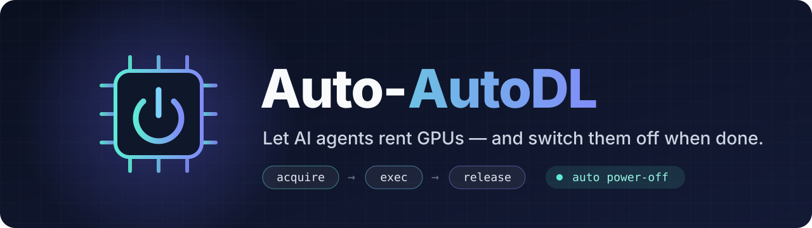
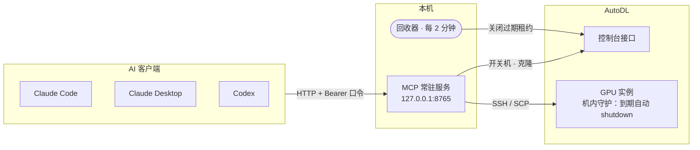

<div align="center">



<h3>让 AI 自己租 AutoDL GPU，用完自动关机</h3>

<p>
  <a href="LICENSE"></a>
  
  
  
</p>

<p>
  <b>中文</b> · <a href="README.en.md">English</a>
  &nbsp;|&nbsp;
  <a href="#-快速开始">快速开始</a> ·
  <a href="#-工具一览">工具</a> ·
  <a href="#-工作原理">原理</a> ·
  <a href="#%EF%B8%8F-配置">配置</a> ·
  <a href="#%EF%B8%8F-安全与注意事项">安全</a>
</p>

</div>

---

**Auto-AutoDL** 是一个本地常驻的 [MCP](https://modelcontextprotocol.io) 服务，让 Claude Code、Claude Desktop、Codex 等 AI 客户端直接申请、使用、释放 [AutoDL](https://www.autodl.com) GPU 实例。多个窗口共用**同一个服务**，互不抢机器，用完及时关机，每一步都有日志。全程走控制台接口，不用点网页。

```text
你：帮我在 4090 上跑一下这个训练脚本，跑完把 checkpoint 拉回来
AI：autodl_acquire → autodl_put → autodl_exec(background) → autodl_job_status → autodl_get → autodl_release ✓ 已关机
```

> [!WARNING]
> **免责声明**
> - 本项目是个人工具，**与 AutoDL 官方无关**，也未获其认可。
> - 调用的是 AutoDL 控制台前端使用的**非公开内部接口**，随时可能因改版失效；使用前请自行确认不违反 AutoDL 的服务条款。
> - 开机、克隆会**产生真实费用**。代码有多层保险关机，但不保证没有 bug，请定期在控制台核对机器状态和余额。按 MIT 协议“按原样”提供，作者不对任何费用或数据损失负责。

## ✨ 特性

<table>
<tr>
<td width="50%" valign="top">

**🎯 统一分配**<br>
有空闲卡的关机机器直接开机；没有就每秒刷新等待；等满仍没有则自动克隆同配置机器（含数据盘）。

</td>
<td width="50%" valign="top">

**🔒 租约隔离**<br>
持有 `lease_id` 才能执行命令、传文件、关机。分配在跨进程锁里完成，多个 AI 窗口不会抢到同一台、也不会误关别人的机器。

</td>
</tr>
<tr>
<td valign="top">

**⏻ 三层保险关机**<br>
主动 `release` → 服务内回收器 → 机器内守护脚本到点自己 `shutdown`。本地电脑关机、服务挂了也不会一直计费。

</td>
<td valign="top">

**📜 全程留痕**<br>
平台操作和每台机器的命令会话按行追加记录，带毫秒时间戳；写入前对常见的 token / 密码写法自动脱敏，root 密码也不会返回给 AI。

</td>
</tr>
</table>

## 🚀 快速开始

**环境要求**：Python 3.10+；本地有 OpenSSH 客户端（`ssh` / `scp`），且 AutoDL 实例里已加好你的公钥。

> Windows 是主要使用平台：剪贴板登录、`install_*.ps1` 计划任务只适用于 Windows。Linux / macOS 下核心功能可用，常驻服务请自行用 systemd / launchd 等托管。

**1. 安装依赖**

```bash
pip install -r requirements.txt
```

**2. 准备 SSH 密钥**：默认使用 `~/.ssh/id_ed25519`，把对应公钥加到 AutoDL 实例里；用别的密钥请在 `config.json` 里设置 `ssh_key`。

**3. 登录 AutoDL**（token 只存在本机 `.secrets/auth.json`，已被 `.gitignore` 排除）

在已登录的控制台页面按 <kbd>F12</kbd> → Console，执行：

```js
copy(JSON.stringify({token:localStorage.token,app_version:localStorage.app_version}))
```

然后：

```bash
python autodl_cli.py login     # Windows：读剪贴板
python autodl_cli.py login -   # Linux / macOS：粘贴后按 Ctrl-D
```

看到“验证通过”即成功。token 过期后重复这一步。

**4. 启动服务**

```powershell
# Windows 开机自启（推荐）：计划任务，崩溃自动重启，无窗口。加 -DryRun 只检查不注册
powershell -ExecutionPolicy Bypass -File install_service.ps1
```

```bash
# 或者手动前台运行
python mcp_server.py --http --port 8765
```

首次启动会在 `.secrets/service_token` 生成访问口令。**别贴到聊天里，也别提交到 git。**

**5. 连接客户端**：地址 `http://127.0.0.1:8765/mcp`，请求头 `Authorization: Bearer <口令>`

```bash
claude mcp add --scope user --transport http autodl http://127.0.0.1:8765/mcp \
  --header "Authorization: Bearer <口令>"
```

<details>
<summary><b>Codex</b>（<code>~/.codex/config.toml</code>，键名请按你的 Codex 版本核对，未经验证）</summary>

```toml
[mcp_servers.autodl]
url = "http://127.0.0.1:8765/mcp"
bearer_token_env_var = "AUTODL_MCP_TOKEN"   # 先把口令设为用户环境变量 AUTODL_MCP_TOKEN
tool_timeout_sec = 3600
```
</details>

<details>
<summary><b>Claude Desktop</b>（需 <code>mcp-remote</code> 做 HTTP→stdio 转接，未经验证）</summary>

```json
"autodl": {
  "command": "npx",
  "args": ["-y", "mcp-remote", "http://127.0.0.1:8765/mcp", "--header", "Authorization:${AUTODL_AUTH}"],
  "env": {"AUTODL_AUTH": "Bearer <口令>"}
}
```
</details>

<details>
<summary><b>stdio 模式</b>（不想常驻服务时的备用方案）</summary>

由客户端按需拉起 `python mcp_server.py`，每个会话一个进程，工具和规则完全一样。
</details>

> [!TIP]
> 客户端的工具超时各不相同（常见 60 秒）。申请机器用 `acquire` + `acquire_status` 轮询、长命令用 `background=true` 已经规避了这个问题，但仍建议把客户端的工具超时调大。

**6.（可选，Windows）** `powershell -ExecutionPolicy Bypass -File install_reaper.ps1`：服务没开时也能每 5 分钟回收一次。

## 🧰 工具一览

| 工具 | 作用 |
|---|---|
| `autodl_acquire` | 申请机器。最多等 `wait_seconds`；就绪返回 `lease_id`，否则返回 `ticket` |
| `autodl_acquire_status` | 轮询申请进度，`state=ready` 时拿到 `lease_id` 和登录信息 |
| `autodl_exec` | 在租约机器上执行命令（支持多行）；长任务用 `background=true` |
| `autodl_job_status` | 后台任务状态与日志末尾 |
| `autodl_put` / `autodl_get` | 上传 / 下载文件或目录 |
| `autodl_renew` | 续租 |
| `autodl_release` | **用完调用**：关机并撤销租约 |
| `autodl_power_off` | 关机；他人租用的机器需对应 `lease_id` |
| `autodl_clone` | 手动克隆，默认只预览 |
| `autodl_list` · `autodl_machines` · `autodl_quota` · `autodl_balance` · `autodl_logs` | 只读查询 |

命令行 `python autodl_cli.py` 提供同样的能力（不带参数查看全部命令），和服务共用同一份磁盘状态，可同时使用。

## 🧭 工作原理



**申请流程**：有空闲卡的关机机器 → 开机 → 等 running → 安装机内守护 → 发放租约。没有空闲卡时每秒刷新，最多等 `wait_seconds`，仍没有就克隆同配置机器，并等数据盘复制完成。

**租约时长**：空闲超时默认 30 分钟，每次操作自动顺延；长传输、长前台命令按其超时顺延；后台任务在跑时不回收；硬上限 12 小时。

**三层保险关机**

| 层 | 触发 | 兜底场景 |
|---|---|---|
| ① `release` | AI 用完主动调用 | 正常流程 |
| ② 回收器 | 服务内每 2 分钟，可选 Windows 计划任务每 5 分钟 | AI 忘了释放 |
| ③ 机内守护 | 租约到期 +5 分钟，实例自己 `shutdown` | 本地电脑关机、服务挂了 |

<details>
<summary><b>更多细节：状态、登录信息、克隆配额、日志格式</b></summary>

- **无状态 HTTP + JSON 响应**：重启服务后客户端无需重新握手；所有状态都在 `state/`，重启不丢租约。工具都在线程池里执行，一个窗口的长命令不会卡住其他窗口。
- **机器登录信息统一登记**：`machines.json` 记录每台机器当前的主机、端口、用户、密钥路径、克隆来源，每次查询自动刷新；同时生成 `ssh_config.autodl`，在 `~/.ssh/config` 里 `Include` 它就能用 `ssh autodl-001` 这类别名。**不保存密码**。
- **克隆配额**：默认每天最多 10 次（北京时间自然日），计数在 `state/clone_log.json`，超出直接拒绝。
- **日志**（只追加，时间精确到毫秒）
  - `logs/autodl/YYYYMMDD.log`：平台操作
    ```text
    [2026-10-07 12:34:56.789] POWER_ON       OK   owner=my-project/train-01 lease=a1b2c3 instance=001机 mode=gpu
    ```
  - `logs/linux/YYYYMMDD_autodl-<编号>.log`：每台机器的命令会话，TeraTerm 格式
    ```text
    [2026-10-07 12:34:56.789] [root@autodl-001 ~]$ nvidia-smi
    [2026-10-07 12:34:57.012] <输出行，含 stderr>
    ```
</details>

## ⚙️ 配置

在 `config.json` 里覆盖，未写的键用默认值，改后重启服务生效。

| 键 | 默认 | 说明 |
|---|---|---|
| `wait_seconds` | `300` | 没有空闲卡时最多等多久，之后改为克隆 |
| `poll_seconds` | `1` | 等待时的刷新间隔 |
| `auto_clone` | `true` | 等满后是否自动克隆 |
| `clone_data_disk` | `true` | 克隆时是否复制数据盘 |
| `max_clones_per_day` | `10` | 每天最多克隆次数（北京时间自然日） |
| `lease_ttl_minutes` | `30` | 租约空闲超时，每次操作自动顺延 |
| `max_lease_hours` | `12` | 租约硬上限，到点强制关机 |
| `guard_grace_minutes` | `5` | 机内守护比租约到期晚多久关机 |
| `reap_grace_minutes` | `10` | 无租约的自启机器多久后被回收 |
| `adopt_running` | `false` | 是否允许接管你自己开着的无租约机器 |
| `ssh_key` | `~/.ssh/id_ed25519` | 登录实例用的私钥路径 |
| `region_groups` | `[["west-B","west-C","west-D","west-E"]]` | 可互相克隆的地区分组；你的实例在别的地区时按需添加 |
| `transfer_roots` | `[]` | `autodl_put` / `autodl_get` 允许的本地目录；为空表示不限（敏感路径始终拒绝） |

## 🛡️ 安全与注意事项

> [!CAUTION]
> 服务只绑定 `127.0.0.1`，**不要改成 `0.0.0.0` 暴露到网络**。拿到口令的人可以在你的实例上执行任意命令并消耗你的余额。

- `autodl_put` / `autodl_get` 始终拒绝传输敏感路径：`~/.ssh`、私钥、本项目的 `.secrets/` 和 `state/`，下载也不能写进本项目目录。建议在 `config.json` 里设置 `transfer_roots`，只允许数据目录。
- 以下文件包含凭据或个人信息，已被 `.gitignore` 排除，**不要提交**：`.secrets/`、`state/`、`logs/`、`machines.json`、`ssh_config.autodl`。
- 日志脱敏是尽力而为，只覆盖常见写法（`--token xxx`、`XXX_TOKEN=xxx`、`Bearer xxx`、`hf_` / `sk-` 开头的密钥等）。敏感值尽量放在实例上的环境文件里，不要直接写进命令。
- 连接实例时关闭了 SSH 主机指纹校验（AutoDL 克隆、换机后主机和端口会变），请只在可信网络中使用。
- 克隆只能在同一地区内（见 `region_groups`）；部分宿主机不支持克隆，代码会自动换下一台。
- 你在网页上自己开的机器不受租约保护，也不会被回收器关掉，除非用 `autodl_acquire(prefer=…)` 接管。
- 接口来自控制台前端，AutoDL 改版可能失效；失效时会报错，需要更新 `autodl_core.py`。

## 🤝 参与贡献

欢迎提 Issue 和 PR，尤其是 AutoDL 接口变动的适配。项目结构和开发约定见 [AGENTS.md](AGENTS.md)。

## 📄 许可证

[MIT](LICENSE) © shenk-ana
